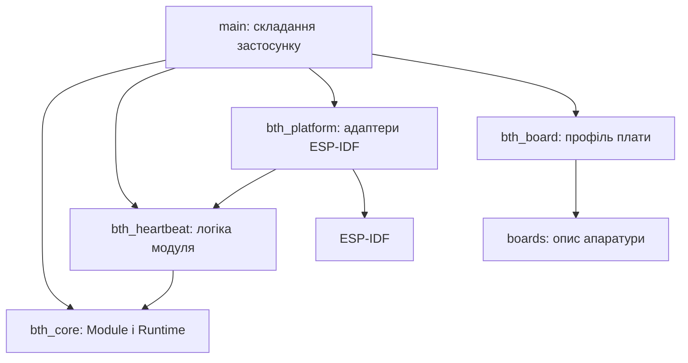

# Архітектура

Мета — додавати можливості окремими компонентами, перевіряти логіку без плати та
зберігати передбачуваний порядок запуску й звільнення ресурсів. Початкова реалізація
невелика: координатор життєвого циклу, один діагностичний модуль і адаптер ESP-IDF.

## Межі компонентів

Стрілки показують залежності коду. `bth_heartbeat` визначає потрібний йому інтерфейс
`HeartbeatSink`. Адаптер `EspHeartbeatSink` реалізує його через ESP-IDF. Модуль
отримує адаптер через конструктор; у тестах замість нього передається `FakeSink`.
Для нової периферії застосовується той самий підхід: вузький інтерфейс і конкретний
драйвер, який його реалізує.

`main/application.cpp` створює об'єкти, з'єднує залежності, реєструє модулі та запускає
цикл. Бізнес-логіка залишається всередині модулів. Глобального реєстру сервісів,
автоматичного пошуку компонентів чи статичної реєстрації немає.

## Два види залежностей

| Вид | Де оголошується | Для чого |
| --- | --- | --- |
| Компіляція | `REQUIRES` / `PRIV_REQUIRES` у CMake | Заголовки й компонування |
| Життєвий цикл | `Module::dependencies()` | Порядок ініціалізації, запуску й зупинки |

Ін'єкція об'єкта через конструктор передає конкретну залежність. Якщо робота модуля
потребує іншого запущеного модуля, додатково вкажіть його ID у `dependencies()`.
Сам масив залежностей не шукає й не передає об'єкти.

Реєстрація йде від постачальників до споживачів. Runtime перевіряє весь список до
першого `init()`: відсутні залежності, неправильний порядок і цикли зупиняють запуск.
Автоматичного переставлення немає — порядок видно в одному місці в коді.

## Життєвий цикл

| Виклик | Контракт |
| --- | --- |
| `init()` | Перевірити конфігурацію, отримати ресурси; залежності вже ініціалізовані, але ще не запущені |
| `start()` | Почати роботу; попередні модулі вже запущені |
| `tick(now_ms)` | Виконати короткий крок; час монотонний, у мілісекундах, 64 біти |
| `stop()` | Зупинити роботу, завершити власні задачі, відключити callbacks; залежності ще працюють |
| `deinit()` | Звільнити ресурси; залежності ще ініціалізовані, але вже зупинені |

Послідовність для A → B: `A.init, B.init, A.start, B.start`, потім послідовні ticks.
Зупинка: `B.stop, A.stop, B.deinit, A.deinit`.

Якщо `B.init` повернув помилку, Runtime викликає `B.deinit`, потім `A.deinit`.
Якщо `B.start` повернув помилку, він викликає `B.stop`, потім зупиняє попередні модулі
та деініціалізує всі ініціалізовані. Так прибираються й частково отримані ресурси.
Помилка `tick` припиняє поточний цикл та зупиняє весь застосунок.

`stop()` і `deinit()` мають бути **ідемпотентними**, придатними до часткового стану
й гарантовано завершуватись. Модуль сам відстежує, які ресурси він уже отримав.
Повернення з `stop()` означає, що жоден worker/callback більше не використовує стан
модуля. Runtime не може виконати цю гарантію замість драйвера.

Після помилки доступні `status`, `phase`, `module`, `dependency`. Runtime переходить
у `failed`, автоматичного reboot/retry немає. Для свідомого повторного запуску
викличте `stop()`, усуньте причину й викличте `start()`. Після першої спроби запуску
склад модулів фіксований; для іншого набору створіть новий Runtime.

Спроба некоректного виклику API повертає `invalid_state`. Діагностика містить останню
помилку API; читайте її одразу. `stop()` її зберігає, новий дозволений `start()` очищає.

## Потоки, пам'ять і помилки

- Runtime використовує масив на 16 модулів і не виділяє динамічну пам'ять. Він не
  володіє модулями: залежності, модулі, рядки ID й масиви залежностей мають жити довше.
  Оголошуйте Runtime після об'єктів модулів; його деструктор викликає зупинку.
- Усі методи Runtime викликаються з одного завдання, без повторного входу з callbacks.
  Власні задачі модулів обмінюються даними через обмежені черги або інші явно
  синхронізовані інтерфейси. ISR не викликає Runtime.
- `tick()` не виконує очікування мережі, довгі транзакції чи `vTaskDelay()`. Власний
  worker потрібен лише коли це виправдано. Не створюйте задачу для кожного модуля
  автоматично. Період опитування за замовчуванням — 20 ms із паузою FreeRTOS;
  точний час виконання чи дедлайни цим не гарантуються.
- `Status != ok` у lifecycle означає фатальну для поточного застосунку помилку.
  Перепідключення Wi-Fi чи тимчасова відсутність сенсора зазвичай обробляються
  внутрішнім автоматом станів модуля з поверненням `ok`, якщо робота може тривати.
- C++ exceptions не використовуються. Помилки ESP-IDF адаптер перетворює на Status
  і логує деталі локально. Відмова модуля має бути видимою, без стирання NVS чи
  нескінченного циклу перезавантажень.
- Це один процес із загальною пам'яттю. Runtime обробляє повернуті помилки, але не
  захищає від зависання коду, пошкодження пам'яті чи порушення контрактів модулем.

## Коли розширювати основу

Сховище налаштувань, мережа, OTA, черга подій чи політика деградації з'являються під
конкретний сценарій. Наприклад, якщо декільком модулям потрібна конфігурація,
додається типізований інтерфейс сховища, ESP NVS адаптер і тести міграції/помилок.
Наявність папки або компонента сама по собі не повинна запускати периферію.
