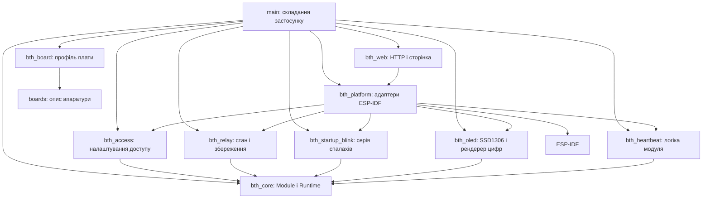

# Архітектура

Оцінка автономності реалізована переносним `bth_battery`. Він отримує
звіти `MainsSink` / `DcSink`, веде баланс заряду за прийнятими струмами
та передає `BatteryEstimate` до OLED через `BatterySink`. `BatteryStore`
ін'єктується; NVS-адаптер розташований у `bth_platform`. Порядок реєстрації:
`nvs → mains → dc → battery → oled`, далі решта керувальних модулів.
Запис контрольної точки виконує власник через `service()` після tick;
помилка запису зупиняє Runtime. Додаткових задач і callbacks немає.
[Формули, формат та обмеження](BATTERY.md).

Matter-варіант (`BTH_WITH_MATTER=ON`) замінює радіоперемикач на адаптер
`bth_matter`: `nvs → access → relay → matter → web → boot_button`.
ESP-Matter керує Wi-Fi STA та BLE-сполученням; вебсервер використовує готову
мережу без власного AP. SDK callbacks надсилають обмежені неблокувальні
команди до спільного relay worker. `tick` синхронізує фактичний стан лише коли
черга реле порожня, отримуючи CHIP lock без очікування.
Portable `MatterRelayGate` ігнорує відновлення SDK до запуску та локальний
зворотний запис, а після `stop` відхиляє команди. ESP-Matter не перезапускається
в межах одного запуску застосунку. Окремий NVS `matter_nvs` не стирається
автоматично. [Стан реалізації та збірка](MATTER.md).

Ліміт Matter endpoints — щонайменше 7: кореневий вузол, розетка з вимірюванням
основної напруги, датчик резервної напруги, сумісний температурний датчик
та окремий AC Electrical Sensor (endpoint 4), другий температурний датчик (endpoint 5),
температурний датчик середньої основної напруги (endpoint 6).
Endpoint 5 передає фактичну DC-напругу як MeasuredValue = volts × 100,
має межі 0–3005 та FixedLabel `name=Резерв`. Він отримує ті самі звіти ADC,
що й DC endpoint 2; недостовірні дані перетворюються на `null`.
Endpoint 3 має Temperature Measurement із фактичною основною напругою
в масштабі volts × 100; одиниця панелі «Напруга» може залишитися °C.
Стандартні AC/DC метадані обслуговуються на endpoints 1, 2 і 4.
Endpoint 4 дублює виміряні Voltage/RMSVoltage розетки, включно з
null за недостовірних даних і повторною спробою за помилки будь-якого оновлення.
Endpoint 6 має Temperature Measurement із ковзним середнім за 60 останніх
дійсних каліброваних секундних вимірювань; невалідний звіт очищує вікно.
Його FixedLabel — `name=Середня напруга`; значення масштабується як volts × 100,
і застосунок-контролер може показати одиницю °C.
FixedLabel на endpoints 3 і 4 містить `name=Напруга`, на endpoint 5 — `name=Резерв`.
Провайдер ProductInfo змінює ProductName
та ProductLabel на B-T HOME, делегуючи інші поля штатному провайдеру SDK.
Обидва провайдери встановлюються під CHIP lock і відновлюються перед зупинкою SDK;
масив міток живе у MatterModule. Сумісні датчики показують виміряну напругу й не керують реле.
Перемикач охорони видалено.
Додаткові `RMSVoltage` і `Voltage` створюються явно як nullable-атрибути,
якими керує застосунок через сховище ESP-Matter. Вони не мають прапорця
`MANAGED_INTERNALLY`, який потребує окремого SDK delegate. До достовірного
вимірювання значення `null`; оновлення виконуються під CHIP lock у `tick`.
`MeasurementAccess` обслуговує обов’язкові `PowerMode`, `NumberOfMeasurementTypes`,
`Accuracy` та `ActivePower`, які ESP-Matter створює з `MANAGED_INTERNALLY`.
Обробник реєструється під CHIP lock під час запуску й видаляється перед зупинкою
SDK. Без нього локальний запис Voltage не означає, що контролер може прочитати
весь кластер. Потужність невідома (`null`), бо вимірюється лише напруга.
Accuracy містить програмні межі значень; відсоткова й абсолютна похибка не
заявляються без калібрувальних даних. Power Topology явно має NodeTopology.
Розетка також містить `Electrical Sensor`: основна RMS-напруга публікується
в `Voltage`/`RMSVoltage` на розетці. Якщо оновлення будь-якого
атрибута не вдалося, звіт залишається очікувати повторної спроби.
Режим тестової напруги видалений із Kconfig та адаптера. Початкове значення
всіх показів напруги — null; надалі вони оновлюються зі звітів ADC.
Помилка публікації залишає відповідний звіт для повторної спроби.
OnOff узгоджується з RelayService під CHIP lock до відкриття шлюзу команд.

`PairingRetry` зберігає запит BOOT, доки SDK асинхронно відкочує незавершене
сполучення. Довге натискання запитує штатний `esp_matter::factory_reset()`:
він очищує Matter-прив’язки та Wi-Fi й перезапускає плату. Цей запит має
пріоритет навіть під час незавершеного rollback; коротке натискання його не
скасовує. Скидання виконується одноразово до перезапуску.
`service_pairing()` викликається власником після `Runtime::tick`, бо SDK може
записувати NVS. Налаштування реле, вебдоступу й Zigbee зберігаються.

Вимірювання мережі: `bth_mains` залежить лише від `bth_core` та отримує
`MainsInput` / `MainsSink` через конструктор. `EspMainsInput` у `bth_platform`
збирає відліки ADC через DMA, а `EspMainsSink` друкує секундний звіт.
`tick` виконує обмежене неблокувальне читання; `stop` зупиняє ADC до звільнення
буферів у `deinit`. [Контракт, підключення й калібрування](MAINS.md).

DC-вхід: `EspMainsInput` також реалізує вузький `DcInput`. Один continuous ADC
обслуговує обидва канали по 2 кГц, розділяє відліки за номером каналу та накопичує
відкалібровані мілівольти DC до наступного читання. `DcModule` у `bth_dc`
усереднює їх за секунду, враховує дільник і передає `DcReading` через `DcSink`.
Composition root оголошує lifecycle-залежність `dc → mains`; `mains` запускає ADC
до `dc` та зупиняє після нього. OLED циклічно показує сторінки по 3 с із
незалежною перевіркою свіжості. [DC-вхід](DC_INPUT.md).

`MainsHistoryTracker` у `bth_mains` рахує поточний та попередній періоди
за монотонним часом Runtime і достовірними відкаліброваними RMS-вимірюваннями.
Знімок історії входить до `MainsReading`: OLED додає дві сторінки часу,
а вебадаптер копіює його разом із напругами в чергу для HTTP-задачі.
Немає спільного змінюваного стану між HTTP та Runtime. Історія не записується в NVS.

`bth_zigbee` — адаптер ESP Zigbee SDK із portable-інтерфейсом `ZigbeeControl`
для вебу та тестованою політикою `ZigbeeJoinWindow`. Порядок керування:
`nvs → access → relay → radio → boot_button`. `RadioMode` у portable-компоненті
`bth_radio` володіє lifecycle двох взаємовиключних груп: `zigbee` або `wifi → web`.
Об'єкти явно створює composition root; постачальники NVS/access/relay належать
зовнішньому Runtime. Перед запуском нової групи попередня повністю зупиняється
та деініціалізується у зворотному порядку, включно з частково невдалими операціями.
Перемикання виконується власником після `Runtime::tick`, оскільки може чекати
завершення мережевих задач. Помилка перемикання зупиняє весь Runtime без reboot.
GPIO-кнопку опитує `BootButton` у `bth_platform`, portable `BootGesture`
фільтрує брязкіт і повертає дію після відпускання. Zigbee callback надсилає
неблокувальну команду тому самому relay worker, що обслуговує HTTP; відповіді
асинхронного клієнта не потрапляють у чергу HTTP. Лічильник незавершених команд
утримує синхронізацію ZCL до завершення роботи relay worker.
Runtime `tick` використовує SDK lock лише без очікування; HTTP обмінюється з
адаптером через обмежені черги. Zigbee mainloop працює у власній задачі.
`stop` забороняє нові команди, зупиняє mainloop і чекає його завершення;
`deinit` відключає callbacks і звільняє descriptors, SDK та черги до зупинки
постачальників. Один приватний вказівник маршрутизує SDK callbacks без context
до єдиного радіоадаптера; пошуку інших модулів через нього немає.
[Докладніше](ZIGBEE.md).

Мета — додавати можливості окремими компонентами, перевіряти логіку без плати та
зберігати передбачуваний порядок запуску й звільнення ресурсів. Початкова реалізація
невелика: координатор життєвого циклу, діагностичний модуль, стартова RGB-індикація та адаптери ESP-IDF.

## Межі компонентів

Стрілки показують залежності коду. `bth_heartbeat` визначає потрібний йому інтерфейс
`HeartbeatSink`. Адаптер `EspHeartbeatSink` реалізує його через ESP-IDF. Модуль
отримує адаптер через конструктор; у тестах замість нього передається `FakeSink`.
Для нової периферії застосовується той самий підхід: вузький інтерфейс і конкретний
драйвер, який його реалізує.

`main/application.cpp` створює об'єкти, з'єднує залежності, реєструє модулі та запускає
цикл. Бізнес-логіка залишається всередині модулів. Глобального реєстру сервісів,
автоматичного пошуку компонентів чи статичної реєстрації немає.

## Два види залежностей

| Вид | Де оголошується | Для чого |
| --- | --- | --- |
| Компіляція | `REQUIRES` / `PRIV_REQUIRES` у CMake | Заголовки й компонування |
| Життєвий цикл | `Module::dependencies()` | Порядок ініціалізації, запуску й зупинки |

Ін'єкція об'єкта через конструктор передає конкретну залежність. Якщо робота модуля
потребує іншого запущеного модуля, додатково вкажіть його ID у `dependencies()`.
Сам масив залежностей не шукає й не передає об'єкти.

Реєстрація йде від постачальників до споживачів. Runtime перевіряє весь список до
першого `init()`: відсутні залежності, неправильний порядок і цикли зупиняють запуск.
Автоматичного переставлення немає — порядок видно в одному місці в коді.

## Життєвий цикл

| Виклик | Контракт |
| --- | --- |
| `init()` | Перевірити конфігурацію, отримати ресурси; залежності вже ініціалізовані, але ще не запущені |
| `start()` | Почати роботу; попередні модулі вже запущені |
| `tick(now_ms)` | Виконати короткий крок; час монотонний, у мілісекундах, 64 біти |
| `stop()` | Зупинити роботу, завершити власні задачі, відключити callbacks; залежності ще працюють |
| `deinit()` | Звільнити ресурси; залежності ще ініціалізовані, але вже зупинені |

Послідовність для A → B: `A.init, B.init, A.start, B.start`, потім послідовні ticks.
Зупинка: `B.stop, A.stop, B.deinit, A.deinit`.

Якщо `B.init` повернув помилку, Runtime викликає `B.deinit`, потім `A.deinit`.
Якщо `B.start` повернув помилку, він викликає `B.stop`, потім зупиняє попередні модулі
та деініціалізує всі ініціалізовані. Так прибираються й частково отримані ресурси.
Помилка `tick` припиняє поточний цикл та зупиняє весь застосунок.

`stop()` і `deinit()` мають бути **ідемпотентними**, придатними до часткового стану
й гарантовано завершуватись. Модуль сам відстежує, які ресурси він уже отримав.
Повернення з `stop()` означає, що жоден worker/callback більше не використовує стан
модуля. Runtime не може виконати цю гарантію замість драйвера.

Після помилки доступні `status`, `phase`, `module`, `dependency`. Runtime переходить
у `failed`, автоматичного reboot/retry немає. Для свідомого повторного запуску
викличте `stop()`, усуньте причину й викличте `start()`. Після першої спроби запуску
склад модулів фіксований; для іншого набору створіть новий Runtime.

Спроба некоректного виклику API повертає `invalid_state`. Діагностика містить останню
помилку API; читайте її одразу. `stop()` її зберігає, новий дозволений `start()` очищає.

## Потоки, пам'ять і помилки

- Runtime використовує масив на 16 модулів і не виділяє динамічну пам'ять. Він не
  володіє модулями: залежності, модулі, рядки ID й масиви залежностей мають жити довше.
  Оголошуйте Runtime після об'єктів модулів; його деструктор викликає зупинку.
  Базовий `Module` забороняє копіювання й переміщення: адреса зареєстрованого модуля
  стабільна, а його стан і дескриптори ресурсів не можна випадково продублювати.
- Усі методи Runtime викликаються з одного завдання, без повторного входу з callbacks.
  Власні задачі модулів обмінюються даними через обмежені черги або інші явно
  синхронізовані інтерфейси. ISR не викликає Runtime.
- `tick()` не виконує очікування мережі, довгі транзакції чи `vTaskDelay()`. Власний
  worker потрібен лише коли це виправдано. Не створюйте задачу для кожного модуля
  автоматично. Період опитування за замовчуванням — 20 ms із паузою FreeRTOS;
  точний час виконання чи дедлайни цим не гарантуються.
- `Status != ok` у lifecycle означає фатальну для поточного застосунку помилку.
  Перепідключення Wi-Fi чи тимчасова відсутність сенсора зазвичай обробляються
  внутрішнім автоматом станів модуля з поверненням `ok`, якщо робота може тривати.
- C++ exceptions не використовуються. Помилки ESP-IDF адаптер перетворює на Status
  і логує деталі локально. Відмова модуля має бути видимою, без стирання NVS чи
  нескінченного циклу перезавантажень.
- Це один процес із загальною пам'яттю. Runtime обробляє повернуті помилки, але не
  захищає від зависання коду, пошкодження пам'яті чи порушення контрактів модулем.

## Коли розширювати основу

Сховище налаштувань, мережа, OTA, черга подій чи політика деградації з'являються під
конкретний сценарій. Наприклад, якщо декільком модулям потрібна конфігурація,
додається типізований інтерфейс сховища, ESP NVS адаптер і тести міграції/помилок.
Наявність папки або компонента сама по собі не повинна запускати периферію.

## Як локалізувати зміни

| Що змінюється | Де редагувати | Чим перевіряти |
| --- | --- | --- |
| Порядок запуску, відкат, перевірка залежностей | `bth_core` | Host-тести lifecycle, збірка прошивки |
| Поведінка модуля, таймери, відновлення після тимчасових помилок | Відповідний `bth_<module>` | Host-тести з fake-адаптером |
| Виклики ESP-IDF, драйвер, апаратний ввід/вивід | `bth_platform` або окремий адаптер | Збірка цільового профілю, перевірка на платі |
| GPIO та характеристики плати | `boards/<profile>` і `bth_board` | Збірка профілю, перевірка схеми й плати |
| Набір модулів та ін'єкція залежностей | `main/application.cpp`, `main/CMakeLists.txt` | Host-тести залежностей, збірка прошивки |

Host-збірка компілює `bth_core` та `bth_heartbeat` окремими бібліотеками з власними
include-шляхами й явними залежностями. Ядро не отримує заголовків heartbeat;
portable-бібліотеки компілюються як C++17 без exceptions і RTTI. Для нового модуля
додавайте окрему host-ціль за цим зразком, щоб випадкова зворотна залежність не
ховалася в загальному списку include-шляхів тестового executable.

Під час розширення зберігайте ресурси всередині модуля або адаптера, який ними
керує. Не передавайте Runtime у модулі. Перевіряйте відмови під час отримання
ресурсів і запуску, припинення подальших ticks, повторне очищення та свідомий
повторний запуск. Для апаратних модулів окремо перевіряйте зупинку workers і
callbacks перед звільненням ресурсів.

## Реле та вебінтерфейс

Вебінтерфейс також показує напругу мережі й батареї. `RelayWeb` отримує звіти
через `MainsSink` / `DcSink` у задачі Runtime та публікує копію в чергу на один
`WebVoltages`. HTTP читає цю чергу, а не стан модулів ADC. Черга живе від `init`
до `deinit`, HTTP-задача завершується перед її видаленням. `/api/voltages`
перевіряє сеанс і свіжість кожного показу (2,5 с). [Контракт API](WEB_RELAY.md).

Поточний застосунок додає `NvsStorage`, `RelayService`, `WifiAp`, `RelayWeb`.
NVS є lifecycle-залежністю реле та Wi-Fi, а реле й Wi-Fi — залежностями web.
`RelayController` у `bth_relay` працює з інтерфейсами `RelayOutput` / `RelayStore`;
GPIO та NVS реалізовані в `bth_platform`. `RelayService` володіє worker-задачею,
яка серіалізує команди з HTTP через обмежені черги. `Runtime` залишається
однозадачним. Web не звертається до Runtime чи GPIO напряму.

Порядок підтвердження: commit NVS → встановлення GPIO → відповідь HTTP.
Очікування flash винесене з tick. Завершення HTTP і worker передує звільненню
ресурсів. LwIP — глобальна підсистема ESP-IDF: її деініціалізація в SDK v5.4 не
підтримується; Wi-Fi, netif і власний event loop модуль звільняє.
Деталі контрактів, помилок і фізичних обмежень — [WEB_RELAY.md](WEB_RELAY.md).

## OLED

`OledModule` отримує вузький `OledTransport`; адаптер `EspOledI2c` володіє
виділеною I²C-шиною та пристроєм. Профіль плати явно задає підключення.
У `init` модуль перевіряє адресу через `OledTransport::probe`. Відсутній OLED
є штатним режимом: ресурси звільняються, `start`/`tick` повертають `ok` без I/O.
Перевірка повторюється при наступному запуску; інші помилки залишаються фатальними.
`OledModule` реалізує `MainsSink`; composition root передає секундний звіт
одночасно в лог та OLED через `MainsOutputs`. `report` лише копіює дані, тому
не потребує запущеного дисплея. Обидва виклики працюють у задачі Runtime.
`bth_oled` має публічну залежність від portable-компонента `bth_mains`.
Рендерер і команди SSD1306 тестуються без ESP-IDF. Початковий кадр `B-T HOME`
передається в `start`; тривалість заставки та стартового блимання береться
з одного `startup_ms` (2000 мс) і відраховується від першого tick Runtime.
Вимірювання накопичуються під час заставки, після неї запускається відлік
трьох секунд першої сторінки. `tick` ставить змінений кадр у чергу адаптера без очікування
I²C. Задача `EspOledI2c` обробляє чергу на один кадр і атомарно повідомляє помилки.
`stop` завершує задачу перед вимкненням дисплея, `deinit` звільняє ресурси.
[Деталі OLED](../components/bth_oled/README.md).

## Налаштування доступу

`AccessSettings` у `bth_access` містить defaults, валідацію й порядок commit →
оновлення поточної конфігурації. `AccessStore` та `PasswordCodec` ін'єктуються;
NVS і PBKDF2 реалізовані в `bth_platform`. Lifecycle: NVS → AccessSettings → Wi-Fi → Web.
MAC AP передається явно з composition root. GPIO не пов'язані з обліковими даними.

Після запуску налаштування й таблиця сеансів мають одного власника — HTTP-задачу.
Записи NVS і хешування не виконуються з Runtime.tick. Застосування Wi-Fi передається
через штатну чергу `httpd_queue_work` і виконується на HTTP-задачі після відповіді.
Web.stop приєднує цю задачу до зупинки Wi-Fi та закриття AccessStore. Runtime не
викликається з HTTP-обробників. Невдалий commit налаштувань блокує доступ до
повторної ініціалізації; жодного автоматичного стирання чи reboot немає.
